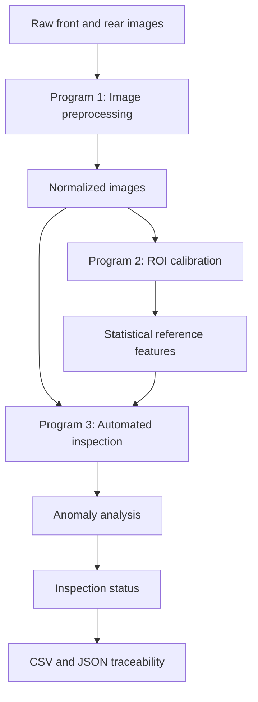
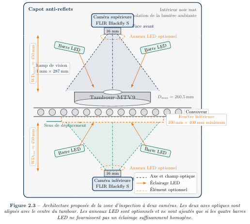
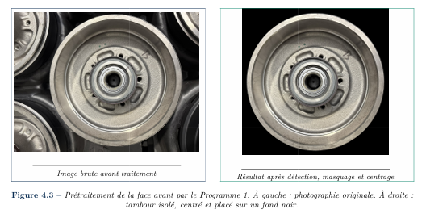
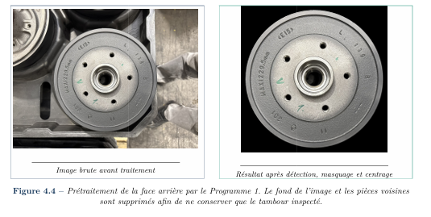
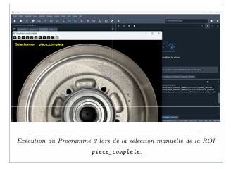

# Industrial Computer Vision — Automated Quality Inspection


## Project Overview

This project was developed during my second-year engineering internship in industrial quality control.

The objective was to design a computer vision system for automated visual inspection of automotive brake drums, combining optical system design, digital image processing, feature extraction and statistical anomaly detection.

The proposed system is designed to inspect both sides of a mechanical component and identify deviations from reference characteristics.

## Project Objectives

- Design an industrial image acquisition system.
- Determine appropriate optical and imaging parameters.
- Detect and isolate the mechanical component.
- Normalize images for reproducible processing.
- Define and calibrate Regions of Interest (ROIs).
- Extract relevant visual and statistical features.
- Identify deviations from reference measurements.
- Ensure inspection traceability.

## Technical Skills

| Domain | Methods and technologies |
|---|---|
| Computer Vision | OpenCV, circular object detection |
| Image Processing | Filtering, masking, resizing, centering |
| Feature Extraction | Contrast, brightness, texture, edges |
| Statistical Analysis | Reference calibration, deviation analysis |
| Scientific Computing | Python, NumPy |
| Optical Engineering | Field of view, spatial resolution, camera and lens selection |
| Data Management | CSV, JSON |
| Software Engineering | Multi-stage processing pipeline |

## System Architecture

The software architecture is organized into three complementary Python programs.



## 1. Optical System Design

The optical acquisition system was designed to provide reproducible images of both sides of the component.

The proposed configuration includes:

- Two industrial cameras.
- Fixed focal length lenses.
- Controlled illumination.
- Front and rear image acquisition.
- A defined working distance.
- Spatial resolution adapted to the targeted inspection requirements.

The optical design was based on the relationship between sensor dimensions, focal length, working distance and field of view.

### Proposed System Architecture



*Figure 1 — Proposed dual-camera industrial inspection system with controlled illumination.*

## 2. Image Preprocessing

The first Python program prepares raw images for subsequent analysis.

### Processing steps

1. Load the original image.
2. Detect the main circular component.
3. Validate or manually correct the detection.
4. Apply a circular mask.
5. Remove the surrounding background.
6. Center the component.
7. Resize the image to 3000 x 3000 pixels.
8. Save the normalized image and processing parameters.

### Main techniques

- Circular Hough transform.
- Geometric object detection.
- Image masking.
- Spatial normalization.
- Image resizing.
- Background removal.

The objective is to reduce variations caused by the initial positioning of the component.

### Front-Side Image Preprocessing



*Figure 2 — Original image and normalized front-side image after circular detection, masking and centering.*

### Rear-Side Image Preprocessing



*Figure 3 — Background removal and spatial normalization of the rear-side image.*

## 3. ROI Calibration and Feature Extraction

The second Python program defines Regions of Interest corresponding to specific areas of the inspected component.

The ROI coordinates are stored and reused across normalized images.

### Extracted features

| Feature | Purpose |
|---|---|
| Mean intensity | Brightness characterization |
| Contrast | Local intensity variation |
| Saturation | Color information |
| Edge density | Structural characterization |
| Texture indicators | Surface appearance analysis |
| Dark pixel ratio | Detection of abnormal dark regions |
| Bright pixel ratio | Detection of abnormal bright regions |

Reference measurements are established using available conforming samples.

The calibration data and extracted features are stored in CSV and JSON files.

### Interactive ROI Calibration



*Figure 4 — Interactive selection of Regions of Interest for localized feature extraction and statistical analysis.*

## 4. Automated Inspection Prototype

The third Python program integrates the previous processing stages into a complete inspection pipeline.

### Inspection workflow

- Load front and rear images.
- Detect and normalize the component.
- Load calibrated ROIs.
- Extract visual features.
- Compare measurements with statistical references.
- Identify abnormal deviations.
- Generate an inspection status.
- Save inspection results.

### Prototype decision statuses

| Status | Meaning |
|---|---|
| OK | Measurements within reference ranges |
| A_VERIFIER | Measurements requiring verification |
| NOK_PROVISOIRE | Significant deviation requiring further investigation |
| ERREUR | Processing or acquisition error |

These statuses are provisional software outputs and are not validated industrial acceptance criteria.

## 5. Results

The development tests demonstrated the feasibility of the proposed software architecture.

The main achievements include:

- Isolation of the main circular component.
- Removal of surrounding objects and background.
- Normalization of front and rear images.
- Interactive ROI calibration.
- Automated extraction of visual features.
- Statistical comparison with reference measurements.
- Structured inspection traceability.

The current implementation is a research and engineering prototype.

## 6. Limitations

The initial development images were acquired using a smartphone rather than the final industrial cameras.

The available dataset mainly contains conforming components.

Consequently:

- Final dimensional calibration remains necessary.
- Industrial decision thresholds require further validation.
- Representative defective samples are required.
- Detection accuracy and false-positive rates have not been established.
- The system has not yet been validated under final production conditions.

## 7. Future Machine Learning Extensions

The current classical computer vision pipeline provides a foundation for future machine learning investigations.

Potential extensions include:

- Isolation Forest for feature-based anomaly detection.
- One-Class SVM for novelty detection.
- Principal Component Analysis (PCA).
- Autoencoder-based anomaly detection.
- PatchCore for visual anomaly localization.
- CNN-based defect classification.

These methods are proposed future extensions and were not implemented or evaluated during the internship.

## 8. Planned Repository Structure

```text
Industrial-Computer-Vision/
|
|-- README.md
|-- requirements.txt
|-- .gitignore
|
|-- src/
|   |-- prog1.py
|   |-- prog2.py
|   |-- prog3.py
|
|-- figures/
|   |-- system_architecture.png
|   |-- front_before_after.png
|   |-- rear_before_after.png
|   |-- roi_calibration.png
|
|-- data/
|   |-- README.md
|
|-- results/
|
|-- report/
    |-- internship_report.pdf
```

The repository structure will be completed progressively, subject to publication authorization.

## 9. Confidentiality

This project originates from an industrial engineering internship.

Industrial images, proprietary data, internal documentation and source code are subject to confidentiality and publication authorization.

Only authorized materials will be made publicly available.

## Author

**Yassine ZAHER**

Engineering Student — Engineering Physics

École d'Ingénieurs Denis Diderot (EIDD)  
Université Paris Cité

Research interests:

Computer Vision | Image Processing | Machine Learning |
Deep Learning | Scientific Computing

[GitHub Profile](https://github.com/YassineZaher)
